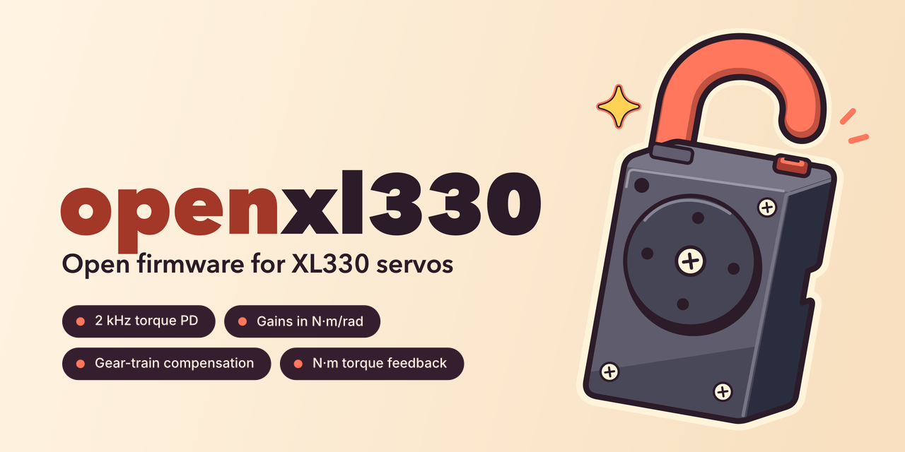
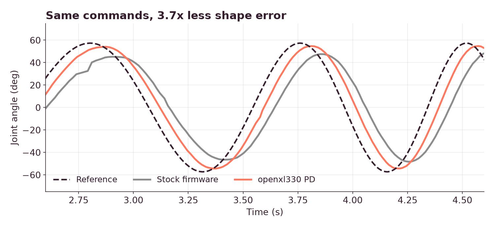
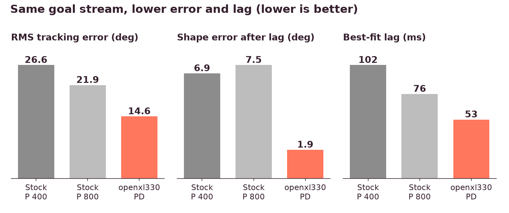
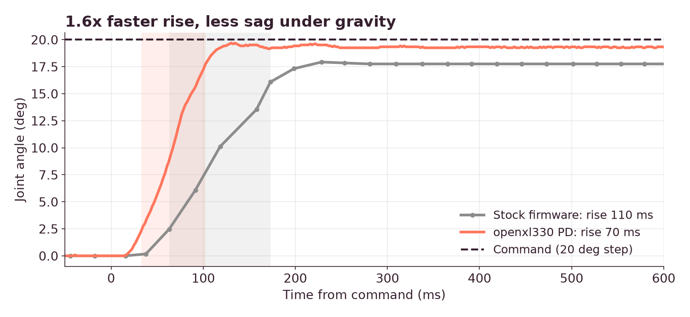

<picture>
  <source media="(prefers-color-scheme: dark)" srcset="https://raw.githubusercontent.com/Jdowdy05/openxl330/main/assets/features/features-card-dark.png">
  <source media="(prefers-color-scheme: light)" srcset="https://raw.githubusercontent.com/Jdowdy05/openxl330/main/assets/features/features-card-light.png">
  
</picture>

<sub>* Stock firmware offers current-based control in mA; openxl330 states gains and torque in N·m using a fixed actuator model, so torque values are estimates (see <a href="https://github.com/Jdowdy05/openxl330/blob/main/docs/torque.md">torque estimates</a>). Torque commands (<code>set_torque()</code>, firmware release 16) are requested output torque through the same model, bounded by the motor's stall torque (full duty) and the configured limit; they are not measured at the horn. Of these cells, only the lag figure is a head-to-head measurement (one unit, one run, see <a href="#performance-vs-stock-firmware">Performance</a>); stock also supports high baud rates.</sub>

# openxl330

openxl330 is replacement firmware for the XL330-M288 smart servo, with a Python library and command-line installer. It provides 2 kHz torque-based position control, gear-train compensation, grouped motion commands, and position, velocity and estimated torque feedback. It uses Dynamixel Protocol 2.0 framing with its own [register map](https://github.com/Jdowdy05/openxl330/blob/main/docs/registers.md).

> **Installing replaces the stock ROBOTIS firmware. There is no supported way back to stock (an experimental route through ROBOTIS Dynamixel Wizard is described in [returning to stock firmware](https://github.com/Jdowdy05/openxl330/blob/main/docs/returning-to-stock.md)). Not affiliated with ROBOTIS. Use at your own risk.**

## Supported hardware

The installer supports the **XL330-M288** (model 1200). The proven starting combinations use stock firmware V50, V52 or V53 and retained loader v6. Use a half-duplex TTL Dynamixel adapter and a separate servo power supply. See [wiring](https://github.com/Jdowdy05/openxl330/blob/main/docs/wiring.md) and [adapter setup](https://github.com/Jdowdy05/openxl330/blob/main/docs/adapters.md).

Set a unique ID for each servo in Dynamixel Wizard while it still runs stock firmware. Install one servo at a time using the [install guide](https://github.com/Jdowdy05/openxl330/blob/main/docs/install.md). This release keeps the ID in the servo’s nonvolatile settings and starts at 1 Mbaud after each boot. The ID you set in Dynamixel Wizard before installing is permanent in v1; changing it after flashing is not supported (except `openxl330 update --allow-id-change`, which moves a servo back to its stock NV ID).

## Install the Python package

Use Python 3.10 or later.

```sh
pip install openxl330
```

Until the package is available on PyPI, build the wheel and source archive from the source tree, then install the wheel in your environment.

```sh
python -m pip install build
python -m build
python -m pip install dist/openxl330-0.1.0-py3-none-any.whl
```

## Quickstart

This example expects three openxl330 servos at IDs 1–3. Replace the example port with the name from `openxl330 ports`. For a bench run, support any load that could fall and keep clear of the joints.

```python
from time import sleep
from openxl330 import Bus

with Bus("/dev/ttyUSB0") as bus:
    with bus.group([1, 2, 3], off_on_exit=True) as arm:
        arm.configure()
        arm.enable()
        arm.move({1: arm.read()[1].position + 0.08}, duration=0.5)
        sleep(0.6)
        print(arm.read()[1].position)
```

To try the same code in simulation, replace `Bus("/dev/ttyUSB0")` with `Bus.simulated(3)`. `off_on_exit=True` requests torque OFF when leaving the group. Confirm that every joint is OFF if communication fails. The [quickstart](https://github.com/Jdowdy05/openxl330/blob/main/docs/quickstart.md) and [examples](https://github.com/Jdowdy05/openxl330/tree/main/examples/) cover discovery, control, calibration, a guided first move, a gripper and simulated installation.

## Performance vs stock firmware

A robot arm is only as good as how faithfully each joint follows what you ask of it. Three properties matter most:

- **Tracking fidelity:** the joint follows the shape of the trajectory, not just its end points.
- **Low lag:** commands take effect quickly, which leaves more room for outer control loops.
- **Stiffness against load:** the joint holds its position under gravity instead of sagging.

We compared the stock firmware with openxl330 on the same XL330 driving a small pendulum (about 290 g at about 30 mm). Both firmwares received the same commands.

### Same commands, better tracking

The host streamed one chirp trajectory, `sin(t²)` rad for 6 s, at about 62 goals per second to both firmwares, with identical goal values and timing.





"Shape error after lag" is the RMS error left after shifting each response by its own best-fit delay. It measures how well the motion keeps the trajectory's shape, separately from how late it arrives.

### Faster steps, less sag

A single 20° step under gravity load illustrates the difference. Across all twelve ±10/20/45° steps and their returns, the 10–90% rise time was 60–104 ms for openxl330 and 105–136 ms for the stock firmware.



### Summary

| Test (one run each) | Stock firmware | openxl330 PD |
|---|---:|---:|
| Chirp, same goal stream: RMS error | 26.6° (P 400) / 21.9° (P 800) | **14.6°** |
| Chirp: shape error after lag | 6.9° / 7.5° | **1.9°** |
| Chirp: best-fit lag | 102 ms / 76 ms | **53 ms** |
| Steps ±10–45°: 10–90% rise | 105–136 ms | **60–104 ms** |
| Steps: mean gravity sag | 1.92° | **0.50°** |
| ±30° sweep: RMS error | 11.9° | **2.2°** |

### How we tested, and caveats

- **Sample size:** one XL330 unit with a pendulum load, and one run per condition.
- **Bus speed:** the stock firmware ran at 57,600 baud because its baud setting lives in its own non-volatile memory, which we did not change. openxl330 ran at 3 Mbaud but replayed the identical goal timeline the stock run received, so the command rate and values were the same.
- **Stock telemetry timing:** stock telemetry is timestamped when the host read returns, and at 57,600 baud that read takes several milliseconds. The stock lag is therefore overstated by a few ms, and stock step timing is resolved only to about 25 ms.
- **Step and sweep tests:** in the step and ±30° sweep tests, openxl330 generated its trajectory on board while the stock firmware received goals streamed at about 40 Hz. The sweep gap is therefore partly a command-rate effect. The chirp test above is the like-for-like comparison.
- **Firmware version:** these measurements used the PD precursor of the released firmware, with gains Kp 2 / Kd 0.05 in the firmware's original torque scale. The released firmware adds gear-train compensation, which tracked better still in our tests (not shown here).
- **Energy:** at stock-matched stiffness openxl330 rises about 25% faster but uses about 20% more energy over the move set; stiffer tunes trade more energy for speed. Energy is V·|duty|·|I| sampled at about 32–40 Hz, which is coarse.
- **No guarantee:** your servo, load, wiring and gains will give different numbers.

The plots were made from the raw recordings of these runs.

## Protections

The firmware turns torque OFF and latches a fault for three protections: supply voltage outside 3.5–7.0 V, temperature at 65 °C or above, and a current overload above 1.0 A RMS (I²t, time constant about 2 s). These defaults apply after every boot, and you can change the limits. There are no travel or speed cut-offs. The only other faults are integrity checks: `sensor` when more than 5 % of encoder or ADC samples in 1 s are bad, and `timing` when more than 5 % of control ticks in 1 s miss their deadline. The [API guide](https://github.com/Jdowdy05/openxl330/blob/main/docs/api.md#protections) shows how to read them.

## Firmware compatibility

| FW231 release | Change |
| --- | --- |
| fast10 | Motion block and Fast Sync Read |
| fast11 | Application reboot after a hang and last-reset diagnostics |
| fast12 | Retargeting during a move, release ID and loader CRC readback |
| fast13 | Caches the loader CRC at boot |
| fast14 | Generates the temperature lookup table from a thermistor model with the same table values as fast13 |
| fast15 | Records when the watchdog's settings fail to apply at start-up (`last_reset()`: `iwdg_update_timeout`) |
| `fw231-comp2-fast16` (bundled default) | Direct torque command in N·m (`set_torque()`; register map ABI 4) |

Use `openxl330 version` to check the bundled release and `openxl330 status --ids 1-3 --port /dev/ttyUSB0` to check what the servos are running. See the [API guide](https://github.com/Jdowdy05/openxl330/blob/main/docs/api.md) for application compatibility and [troubleshooting](https://github.com/Jdowdy05/openxl330/blob/main/docs/troubleshooting.md) for reported faults and errors. Hardware qualification so far (macOS): a six-servo arm on a U2D2. All six were installed from stock V52 with `experimental flash-all`, the torque command was checked, and a 600 s loaded run at 1 Mbaud passed with no faults, resets or missed deadlines. Before that, BusLinker and U2D2 were qualified with three servos on one bus at 1 Mbaud. Not yet checked physically: the 65 °C shutoff.

## Experimental: flash-all and going back to stock

`openxl330 experimental flash-all` installs on every stock servo of a bus in one run, each keeping its ID. `openxl330 experimental uninstall` hands a servo to ROBOTIS Dynamixel Wizard's Firmware Recovery and restores its stock settings afterwards. flash-all has installed a six-servo arm from stock; the route back to stock is tested on one two-servo bench only. See [experimental commands](https://github.com/Jdowdy05/openxl330/blob/main/docs/experimental.md) and [returning to stock firmware](https://github.com/Jdowdy05/openxl330/blob/main/docs/returning-to-stock.md).

## Known limitations

IDs cannot yet be changed over the bus (set them in Dynamixel Wizard before installing; planned for v1.1). A long encoder dropout near top speed latches a sensor fault, and a stuck encoder bus needs a power cycle; fixes for both are designed but not yet in the firmware. There is no graphical tool yet (planned for v1.1). See [known limitations](https://github.com/Jdowdy05/openxl330/blob/main/docs/limitations.md).

## Adapters

Use the U2D2’s three-pin TTL port or a compatible BusLinker-type adapter. An adapter that echoes its own requests is refused. FTDI driver latency can dominate read and write times, especially on macOS. On Windows, set the FTDI latency timer from its 16 ms default to 1 ms in Device Manager → Port Settings → Advanced. Linux and Windows: expected to work, not yet hardware-tested; reports welcome. See [adapters](https://github.com/Jdowdy05/openxl330/blob/main/docs/adapters.md) for detection and latency settings.

## Licence

To report a bug or a hardware result, or to contribute, see [CONTRIBUTING](https://github.com/Jdowdy05/openxl330/blob/main/CONTRIBUTING.md); for security issues, see [SECURITY](https://github.com/Jdowdy05/openxl330/blob/main/SECURITY.md).

The library and the bundled openxl330 firmware are licensed under [MIT](https://github.com/Jdowdy05/openxl330/blob/main/LICENSE). The README images include third-party artwork; see [third-party notices](https://github.com/Jdowdy05/openxl330/blob/main/THIRD_PARTY_NOTICES.md). ROBOTIS and DYNAMIXEL are used to identify the hardware and tools this project interoperates with. See the [changelog](https://github.com/Jdowdy05/openxl330/blob/main/CHANGELOG.md) for release notes and the [torque guide](https://github.com/Jdowdy05/openxl330/blob/main/docs/torque.md) for what the estimates mean.

